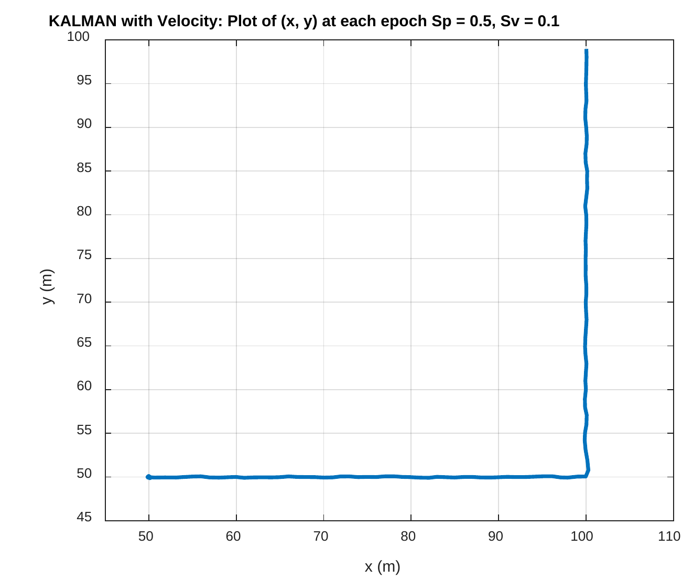
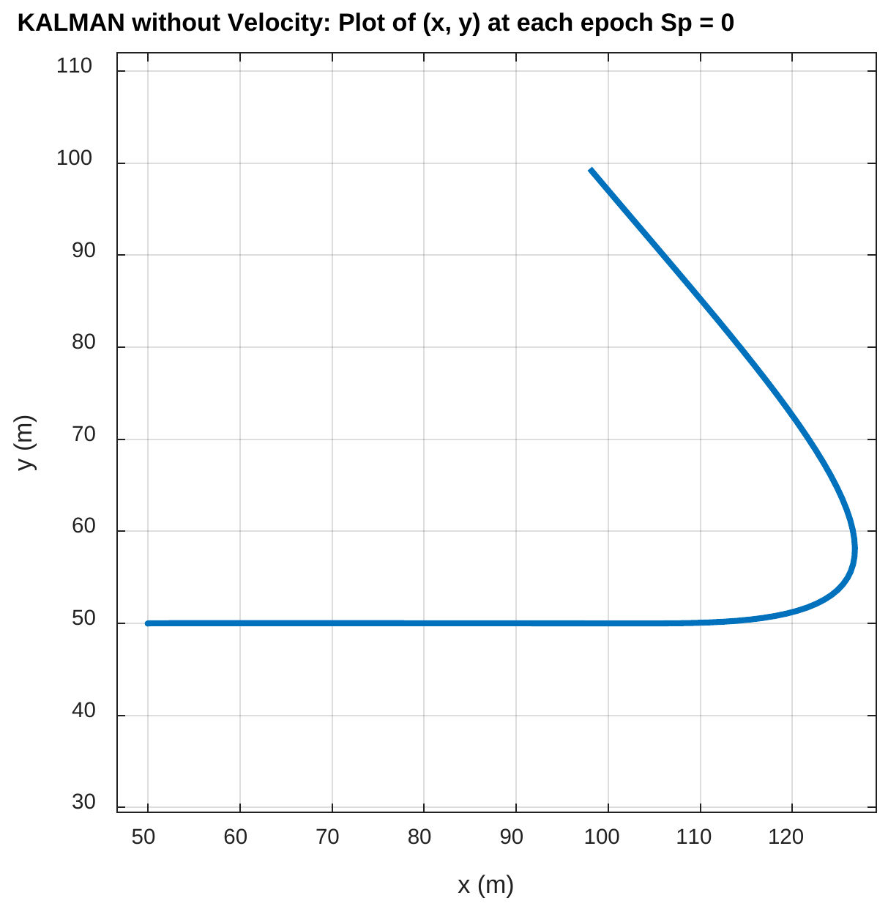
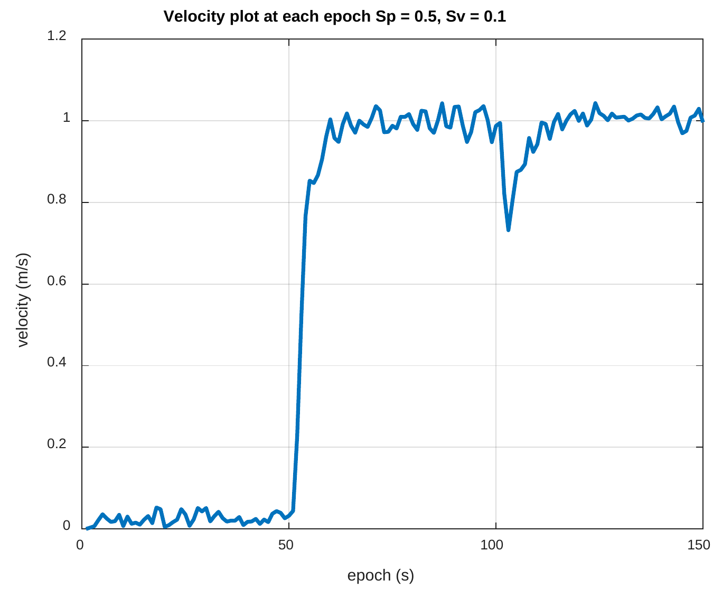

# Range-based positioning: least squares and Kalman filtering (MATLAB)

Estimates the 2D position of a receiver from range measurements to four anchors at the
corners of a 100 m square, first while it is stationary and then while it moves. The same
data set is processed with five estimators to compare how each one behaves:

- batch non-linear least squares
- summation of normals
- sequential least squares
- a Kalman filter with position states only
- a Kalman filter with position and velocity states (constant-velocity model)



## Results

**Stationary epochs (1 to 51).** Batch least squares, summation of normals and sequential
least squares all give the same position, (50.0071, 49.9996) m, with an a posteriori variance
factor of 0.0103 and a near-circular error ellipse (a ≈ b ≈ 1 cm), as expected from the
symmetric anchor geometry. As a check on the error ellipses, the 1-sigma ellipse (39.4%)
from a single epoch contained 20 of the 50 other single-epoch solutions, about 40%.

**Moving epochs (52 to 150).** Sequential least squares assumes a fixed position, so it
breaks down once the receiver starts moving. A Kalman filter handles the motion, but the
dynamic model and its process noise decide how well:

| Model | Behaviour |
|---|---|
| Position only, low process noise (Sp = 0) | Smooth but lags, and overshoots the corner by more than 25 m |
| Position only, high process noise (Sp = 10) | Follows the corner but is jagged, passing measurement noise straight through |
| Position and velocity (Sp = 0.5, Sv = 0.1) | Tracks the L-shaped path closely, and estimates speed: about 0 m/s while stationary, about 1 m/s while moving |





The dip in speed near epoch 100 lines up with a likely blunder in the range observations.

## Method

- **Measurement model:** range to each anchor, r = √((x − xᵢ)² + (y − yᵢ)²), linearized about
  the current estimate. Measurement covariance is the identity (1 m²).
- **Least squares:** iterated until the correction δx is negligible. Error ellipses come from
  the eigen-decomposition of the scaled covariance matrix.
- **Kalman filter:** prediction with a state transition matrix Φ and process noise Q, then a
  measurement update with the linearized range model. For the constant-velocity model, Q is
  derived from the position and velocity spectral densities Sp and Sv (`QkCalc.m`).

## Run it

Open `main.m` in MATLAB (R2014b or later) and run it from the repository root. Each section
(`%% Task ...`) produces one result and its plot.

## Files

```
main.m                       runs every estimator and makes the plots
ParaLS.m                     batch non-linear least squares
SummationLS.m                summation of normals
SequentialLS.m               sequential least squares
IteratedSequentialLS.m       iterated sequential least squares
NoVelocityKalmanFilterLS.m   Kalman filter, position states
KalmanFilterLS.m             Kalman filter, position and velocity states
QkCalc.m                     process noise matrix for the constant-velocity model
ErrorEllipses.m              error ellipse parameters from a covariance matrix
EllipsePlot.m                plots an error ellipse
data/ranges.txt              simulated ranges: epoch, then range to each of the 4 anchors (m)
docs/                        figures from the original analysis
```

Written in 2019 for a wireless location course in Geomatics Engineering at the University of Calgary.
